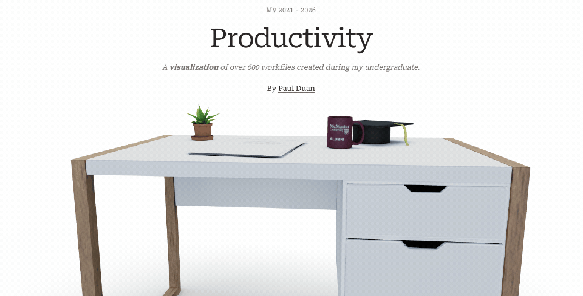

# Productivity (2021–2026) — Undergraduate Visualization

An interactive 3D data story visualizing **567 workfiles** created across five years of undergraduate study (Fall 2021 – Winter 2026). 


## Overview

The experience unfolds in two layers:

- **Landing** — A full-screen 3D scene built with [React Three Fiber](https://docs.pmnd.rs/react-three-fiber).
- **Detail View** — A scroll-driven narrative divided into three acts, paired with live D3 visualizations (punchcard heatmaps, line charts, etc.) on the right panel.

## Tech Stack

| Layer | Technology |
|-------|------------|
| Framework | [Next.js 16](https://nextjs.org) (App Router) |
| UI | [React 19](https://react.dev), [Tailwind CSS 4](https://tailwindcss.com) |
| 3D | [Three.js](https://threejs.org), [React Three Fiber](https://docs.pmnd.rs/react-three-fiber), [Drei](https://github.com/pmndrs/drei) |
| Animation | [GSAP](https://gsap.com) + ScrollTrigger, [@react-spring/three](https://react-spring.io) |

## 🚀 Getting Started

```bash
# Install dependencies
npm install

# Start development server
npm run dev

# Build for production
npm run build

# Run production build
npm start
```

Open [http://localhost:3000](http://localhost:3000) in your browser. The page loads a GLTF model and the cube dataset — allow a moment for assets to stream in.

## Data

All visualization data lives in `data/` as pre-computed JSON:

| File | Description |
|------|-------------|
| `file_summary.json` | Per-file metadata: name, version count, term, course, date, weekday |
| `day_hour_counts.json` | Hourly commit density per day of week |
| `hour_version_counts.json` | Aggregate version counts by hour |
| `ext_courses.json` | Extension requests grouped by course |
| `term_extensions.json` | Extensions per term |
| `term_duration_density.json` | Assignment duration distributions per term |
| `term_empty_days.json` | Days with zero file activity per term |
| `heavy_assignment_commits.json` | High-commit-count assignments |

## Responsive Behavior

The 3D camera adapts to three viewport breakpoints:

| Breakpoint | Width | Behavior |
|-----------|-------|----------|
| `lg` | ≥ 1024px | Side-by-side narrative + chart panels |
| `md` | 768–1023px | Stacked layout, adjusted camera |
| `sm` | < 768px | Full-width stacked, touch-swipe navigation |

Camera positions are defined in `constants/camera.ts` and selected at runtime based on `window.innerWidth`.

## Build & Deploy

The project is configured for deployment on [Vercel](https://vercel.com). Production builds include Google Analytics (ID `G-KNPEXFEH64`). Ensure environment variables are set appropriately for your deployment target.

```bash
npm run build   # outputs to .next/
```
