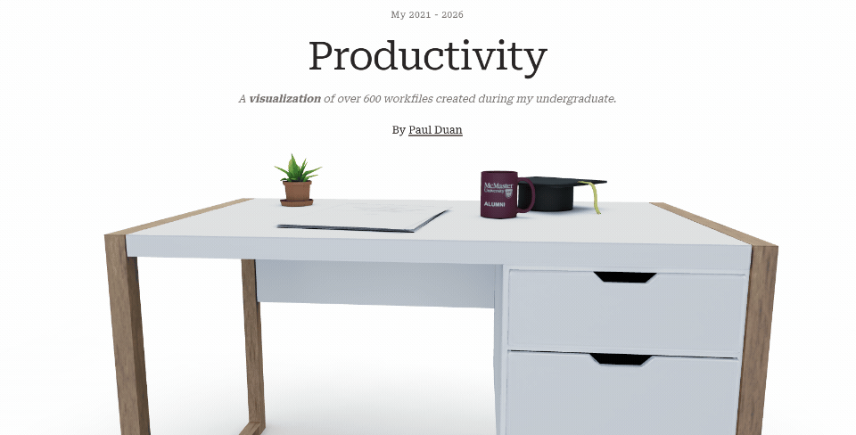

# Productivity (2021–2026) — Undergraduate Visualization

[Productivity (2021–2026) — Undergraduate Visualization](https://xianzhaoduan.com/undergrad-vis/)

An interactive 3D data story visualizing **567 workfiles** created across five years of undergraduate study (Fall 2021 – Winter 2026). 


## Overview

A five-year report read from the version history of a university OneDrive account: **567 workfiles**, **34 courses**, **8 terms**, and **23,906 versions** across 58 major assignments.

The experience has three layers:

- **Cover** — a full-screen 3D desk built with [React Three Fiber](https://docs.pmnd.rs/react-three-fiber). The report's printed cover sits on the paper; the HTML cover is set in the report's own voices and opens the story.
- **Story** — a scroll-driven report in three acts. The reading pane is pinned and read word by word; each highlighted phrase publishes an emphasis that focuses the figure on the right. The reverse also holds: hovering a figure note focuses its phrase in the copy.
- **Plates** — thirteen numbered figures: a 3D cube field (React Three Fiber), a Sankey, a bar-to-stream morph, deadline tracks, and a punchcard (D3 + SVG).

The story is set as a printed report: Instrument Serif for display, Newsreader for running copy, Geist Mono for labels and figures, with justified and hyphenated text, a plate header (figure number and title), and a three-stat rail per step. The phone layout is a scroll story rather than a shrunken spread: a sticky 58dvh figure over a 42dvh reading band.

## Tech Stack

| Layer | Technology |
|-------|------------|
| Framework | [Next.js 16](https://nextjs.org) (App Router) |
| UI | [React 19](https://react.dev), [Tailwind CSS 4](https://tailwindcss.com) |
| 3D | [Three.js](https://threejs.org), [React Three Fiber](https://docs.pmnd.rs/react-three-fiber), [Drei](https://github.com/pmndrs/drei) |
| Animation | [GSAP](https://gsap.com) + ScrollTrigger, [@react-spring/three](https://react-spring.io) |

## 🚀 Getting Started

```bash
# Install dependencies
npm install

# Start development server (the site is mounted at /undergrad-vis)
npm run dev

# Build the static export (outputs to out/)
npm run build

# Build and deploy to Cloudflare Workers
npm run deploy
```

Open [http://localhost:3000/undergrad-vis/](http://localhost:3000/undergrad-vis/) in your browser. The page loads a GLTF model and the cube dataset — allow a moment for assets to stream in.

## Data

All visualization data lives in `data/` as pre-computed JSON:

| File | Description |
|------|-------------|
| `file_summary.json` | Per-file metadata: name, version count, term, course, date, weekday |
| `day_hour_counts.json` | Hourly version density per day of week |
| `hour_version_counts.json` | Aggregate version counts by hour |
| `ext_courses.json` | Extension requests grouped by course |
| `term_extensions.json` | Extensions per term |
| `term_duration_density.json` | Assignment duration distributions per term |
| `term_empty_days.json` | Days with zero file activity per term |
| `heavy_assignment_commits.json` | Assignments with more than 100 versions |

## Responsive Behavior

The story has two real layouts, not a shrunken desktop:

| Layout | When | Behavior |
|--------|------|----------|
| Two-column | ≥ 960px wide, or landscape with ≥ 640×360 | Narrative column + sticky figure column, capped at 1600×920 |
| Scroll story | phones and portrait tablets | 58dvh sticky figure over a 42dvh reading band; top bar carries the figure title, step count and close |
| Landscape phone | landscape below 960px | 55/45 spread: figure beside the reading band |

The 3D camera poses live in `constants/camera.ts` and are selected at runtime; the two-column minimum is `components/detail/responsive.ts`.

## Accessibility & Motion

The whole story is operable without a pointer:

| Input | Cover | Story |
|-------|-------|-------|
| `Tab` | Focuses Open the report, the scene, then the author link | Focuses the story panel; the progress segments and keywords are tab stops |
| `Enter` / `Space` | Opens the story | Activates the focused control |
| `Esc` | — | Closes the story and returns focus to the scene |
| `↓` / `PageDown` | — | Next passage (desktop: scrolls; phone: next step) |
| `↑` / `PageUp` | — | Previous passage |
| `Home` / `End` | — | First / last passage |

The top bar is also a table of contents: each of the three segments is a button that jumps to its act, and a fixed **Return to desk** control is available from any scroll position. On phones the top bar carries a close button instead.

`prefers-reduced-motion: reduce` is honoured throughout: the loader and the cover wipe snap to their final state, the camera cuts instead of flying, pointer parallax is off, and the charts land on their target state instead of tweening. `/#story` opens the story — and the back button closes it rather than leaving the site.

## Metadata

`app/layout.tsx` owns the Open Graph / Twitter metadata (canonical URL, theme colour, social card). The social card is the committed `public/og.png` at 1200×630 — a designed card set in the report's own typefaces, deliberately a static PNG rather than a generated metadata route. `app/sitemap.ts` and `app/robots.ts` are static exports for the same reason.

The narrative copy is also rendered as a visually hidden `StorySummary` section so the text and numbers exist in the initial HTML for crawlers and screen readers.

## Build & Deploy

The canonical site is a **Cloudflare Workers static asset** at [https://xianzhaoduan.com/undergrad-vis/](https://xianzhaoduan.com/undergrad-vis/).

- `next.config.ts` uses `output: "export"` and `basePath: "/undergrad-vis"`; `npm run build` writes the static site to `out/`.
- `wrangler.jsonc` mounts that directory with `assets.base_path: "/undergrad-vis"` and routes `xianzhaoduan.com/undergrad-vis` + `/*` to the Worker. This needs **Wrangler 4.148+**; the deploy script runs `npx wrangler@4.162.0`.
- `npm run deploy` builds and deploys; `npm run preview` runs the Worker locally.
- `public/_headers` sets immutable caching for `_next/static` and basic security headers.

The existing GitHub Pages workflow (`.github/workflows/nextjs.yml`) still builds the same `out/` as a mirror. Its canonical/OG metadata points at the Cloudflare URL, so the mirror does not compete in search.

```bash
npm run build    # static export to out/
npm run deploy   # build + wrangler deploy
```
